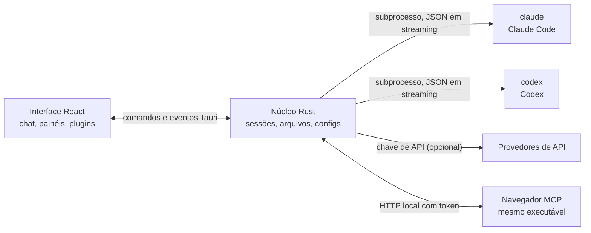

<p align="center">
  
</p>

<h1 align="center">LunaHarness</h1>

<p align="center">
  <strong>Português (Brasil)</strong> · <a href="README.en.md">English</a> · <a href="README.es.md">Español</a> · <a href="README.fr.md">Français</a> · <a href="README.de.md">Deutsch</a> · <a href="README.it.md">Italiano</a> · <a href="README.nl.md">Nederlands</a> · <a href="README.pl.md">Polski</a> · <a href="README.sv.md">Svenska</a> · <a href="README.ru.md">Русский</a> · <a href="README.uk.md">Українська</a> · <a href="README.tr.md">Türkçe</a> · <a href="README.ar.md">العربية</a> · <a href="README.he.md">עברית</a> · <a href="README.hi.md">हिन्दी</a> · <a href="README.id.md">Bahasa Indonesia</a> · <a href="README.vi.md">Tiếng Việt</a> · <a href="README.th.md">ไทย</a> · <a href="README.ja.md">日本語</a> · <a href="README.ko.md">한국어</a> · <a href="README.zh-CN.md">简体中文</a> · <a href="README.zh-TW.md">繁體中文</a>
</p>

<p align="center">
  Um app desktop para conversar com o <strong>Claude Code</strong>, o <strong>Codex</strong> e outros agentes de código numa interface só, com plugins, skills, servidores MCP e um navegador para o agente.
</p>

---

## O que é

O LunaHarness não é um modelo de IA. Ele é uma **casca** em volta das CLIs oficiais que você já usa, como o `claude` (Claude Code) e o `codex` (Codex). O app inicia essas ferramentas, usa o login que você já fez nelas e mostra a conversa numa janela de chat, com o que o agente faz ao lado: alterações de arquivos, plano, progresso, arquivos, terminal e navegador.

A ideia é ter um lugar só para trabalhar com o agente, sem perder o que as CLIs oferecem:

- Trocar de provedor, modelo, esforço e modo de permissão sem reiniciar a conversa.
- Ver o diff do que o agente mudou, desfazer alterações e voltar a um ponto anterior.
- Instalar skills, servidores MCP e plugins uma vez e usar nas CLIs.
- Dar ao agente um navegador próprio para ler e interagir com páginas, ou usar o Playwright.

## Recursos

**Agentes (motores)**
- **Claude Code** e **Codex**: as CLIs oficiais, com o login que você já fez nelas.
- **OpenCode**, **Cline**, **GitHub Copilot** e **Hermes**: cada um como CLI, quando estiver instalado e logado.
- **Antigravity**: aparece na lista de agentes, mas o app ainda não gerencia a conta dele.
- **Perfis de API** para provedores como Anthropic, OpenRouter, DeepSeek, Z.ai, OpenCode Go e Kimi, com a chave guardada no Gerenciador de Credenciais do Windows.
- **Orquestrador**: você escolhe qual agente, modelo e esforço cuida de cada papel (planejar, executar, conversar e subagentes).
- **Contas extras**: mais de uma conta por CLI, em pastas separadas.

**Conversa**
- Respostas em tempo real, com anexos de imagem e de arquivo.
- **Permissões** no seletor do composer: **Só leitura** não escreve arquivos; **Pedir permissão** deixa o agente executar tarefas e, no Claude, abre um pedido no chat antes de ações sensíveis, com Permitir, Negar ou Sempre nesta conversa (nos motores sem esse canal, funciona como Só leitura); **Acesso total** é o padrão em conversas novas. Conversas salvas mantêm a permissão que tinham.
- **Velocidade real** do turno, medida pelos tokens de saída informados pela CLI: ao vivo no Claude e como valor final nos demais motores. Sem a contagem, aparece "sem dados".
- **Diff inline** das edições do Claude, recolhível, com o total de linhas adicionadas (+) e removidas (−) no cabeçalho.
- **Clonador de sites (beta)**: botão no composer que recria o layout de um site dentro do projeto, com aviso de direitos autorais e prévia no navegador embutido. Revise o resultado antes de usar.
- Menu `/` com os comandos da Luna (`/plano`, `/projeto`, `/compactar`, `/meta`, `/subagente`, `/plugin`), além de skills, comandos e plugins de cada CLI.
- Modo **Planejar**: o plano completo vai para o painel **Plano**, e o chat mostra o resumo. Modo **Conversar** para perguntas simples.
- Perguntas do agente viram um seletor de opções em vez de texto.
- **`/meta`**: repete o pedido até o agente sinalizar que terminou, com teto de 20 rodadas.
- **`/subagente`**: uma tarefa em segundo plano, com status e botão de parar (até 3 ao mesmo tempo).
- Compactação de contexto, manual ou automática acima de 90% do limite.
- Trocar de agente, modelo, esforço e permissão sem perder a conversa. Ao trocar de agente no meio, o histórico segue junto.
- Regras globais: um texto seu que vai para o `CLAUDE.md` e o `AGENTS.md`.
- Medição do **cache de prompt** do provedor a cada turno: a taxa de acerto do turno e o motivo provável quando ela cai. Os números ficam disponíveis para plugins (`api.cache.stats()`); o app ainda não tem painel para eles. Para perfis da Anthropic, há a opção de cache de 1 h em Configurações > Conversa.
- Medidor opcional de tokens por segundo no composer.

**Projeto e git**
- Conversa com pasta de projeto, ou **sem pasta**, como no Claude Code.
- **Worktrees**: trabalhar numa branch sem mexer na pasta atual. O seletor mostra a branch atual e as outras.
- Painel **Alterações**: lista de arquivos mudados, com diff e desfazer.

**Painel lateral**
- **Plano** e **Progresso**: o plano do agente e as etapas da tarefa, em ordem, com a porcentagem geral.
- **Arquivos**: árvore do projeto. Clicar num arquivo abre um **editor** no lugar do chat, com salvar, Ctrl+S e auto-salvar opcional.
- **Terminal**: até 4 abas de shell na pasta do projeto.
- **Navegador**: veja a seção abaixo.

**Navegador**
- Navegador embutido no WebView2 do Windows, com até 8 abas, barra de endereço, voltar, avançar e recarregar.
- **Favoritos** e **histórico** próprios, com o histórico limitado a 500 visitas.
- Texto que não é endereço vira **busca** no motor escolhido: Google (padrão), DuckDuckGo, Bing ou Brave.
- **Bloqueador de anúncios**, ligado por padrão, com botão de pausa na barra.
- **Tradução da página** para português pela tradução do Google, com volta ao original.
- **Economia de memória** por aba: a aba suspensa volta quando você a abre.
- **Importação** de favoritos, histórico e senhas exportados do Chrome ou do Edge. As senhas ficam criptografadas com a proteção do Windows (DPAPI), e o app só mostra e copia, sem preencher formulários.
- **Modo navegador**: ocupa a tela inteira, com o chat recolhido numa faixa lateral. Voltar ao modo LunaCode restaura o layout.
- O agente usa o navegador embutido (no Claude e no Codex): lê a página, age nela por referências (clicar, digitar, teclas, rolar e esperar) e pesquisa na web pelo motor escolhido em Configurações > Navegador. Ações sensíveis, como comprar, enviar, publicar ou apagar, pedem confirmação no chat, e login ou CAPTCHA param para você resolver na página.
- O **Playwright** com Chromium também está disponível, e o app instala depois de confirmação (Claude, Codex e OpenCode).
- Extensões do Chrome não funcionam, porque o WebView2 não as instala.

**Extensões**
- **Skills**, **servidores MCP** e **plugins**, instalados pelo catálogo do app ou pelo comando `luna`, e usados nas CLIs.
- **Plugins da Luna**: podem criar painéis na barra lateral, no chat e no composer, comandos, modos, temas e avisos. Cada plugin declara as permissões no manifesto, e o app mostra essas permissões antes de instalar.
- **Plugins criados pela Luna**: ela escreve o plugin numa pasta de rascunhos e mostra um cartão **Instalar**, com as permissões, antes de copiar.
- **Plugins do Claude Code**: a Luna lista, instala, ativa, atualiza e remove pela CLI oficial `claude plugin`, com confirmação e escopo de usuário.
- Segredos de MCP ficam nas variáveis de ambiente do seu usuário. O app nunca mostra o valor.

**Visual e uso**
- Temas Sistema, Claro, Escuro, Luna padrão, Aurora, Duna e Grafite, temas próprios com editor e formatos de componente, e temas de plugin.
- Interface em português (Brasil) e inglês. Por padrão segue o idioma do sistema.
- Animações com ritmo ajustável, que param quando o sistema pede movimento reduzido.
- Sons de resposta opcionais e avisos quando a janela não está em foco.
- Primeira abertura com uma apresentação curta (feita uma vez).
- Atualização pelo próprio app: o app checa ao abrir e a cada hora, e instala em Configurações > Sobre.

## Como funciona



- Cada CLI tem um **adaptador** que traduz a saída JSON dela para eventos internos. O frontend nunca lê o formato bruto.
- O app não guarda suas credenciais das CLIs: quem faz o login é o próprio binário oficial.
- Chaves de API são opcionais, por perfil, e ficam no armazenamento seguro do sistema.
- O navegador embutido é uma webview filha da janela. Ele fala com o agente pelo mesmo executável, em modo MCP, por HTTP local com token.

## Baixar

| Sistema | Situação | Como obter |
|---|---|---|
| **Windows 10 (1809+) e Windows 11** | Disponível | Instalador na [página de releases](https://github.com/GuilhermeFelix95/lunaCode/releases) (`.exe`). |
| **macOS** | Não disponível | Não há instalador. Porte para a comunidade. |
| **Linux** | Não disponível | Não há pacote. Porte para a comunidade. |

- Requisitos no Windows: pelo menos um CLI instalado e logado (`claude`, `codex` ou outro). Não é preciso Node.js nem Rust para quem só usa o app.
- O instalador ainda não tem assinatura de código: o Windows pode mostrar um aviso do SmartScreen. Escolha "Mais informações" e depois "Executar assim mesmo".

## Política de assinatura de código

Code signing policy: os instaladores do Windows são assinados gratuitamente pela [SignPath.io](https://about.signpath.io/), com certificado da [SignPath Foundation](https://signpath.org/).

O projeto é distribuído sob a licença Apache 2.0 (ver `LICENSE`). A inscrição para assinatura gratuita de código aberto na SignPath Foundation está em andamento. Depois de aprovada, valem as regras abaixo:

- Só são assinados os instaladores gerados a partir deste repositório, pelo processo de release.
- O certificado é emitido para a SignPath Foundation, e o editor exibido no Windows será esse.
- Papéis da equipe: autor, revisor e aprovador são exercidos por [@GuilhermeFelix95](https://github.com/GuilhermeFelix95), único mantenedor. Cada publicação é aprovada manualmente antes da assinatura.
- Os membros da equipe com acesso à assinatura, no SignPath e no repositório, usam autenticação em dois fatores.
- A chave de assinatura das atualizações do app é separada e não é usada para assinar o instalador do Windows.
- Privacidade: o processo de assinatura envia à SignPath apenas o instalador gerado a partir deste repositório, sem dados dos usuários do app.

## Pré-requisitos

Hoje o desenvolvimento e o build funcionam só no **Windows**:

- **Windows 10 ou 11**.
- **Node.js** LTS e **npm**.
- **Rust** (toolchain `stable`, `x86_64-pc-windows-msvc`) e as ferramentas de build do Visual Studio (C++).
- Pelo menos uma CLI instalada e logada: Claude Code, [Codex](https://github.com/openai/codex) ou outra.

macOS e Linux não são suportados por enquanto.

## Instalação e execução

Os comandos abaixo rodam no Windows (PowerShell ou Git Bash com Node e Rust instalados).

```bash
git clone https://github.com/GuilhermeFelix95/lunaCode.git
cd LunaHarnes
npm install
```

Para abrir o app em modo de desenvolvimento:

```bash
npm run dev:app
```

Para gerar o executável:

```bash
npm run build:app
```

Para só rodar a interface no navegador (sem o núcleo Rust, então sem as CLIs):

```bash
npm run dev
```

## Testes

```bash
npm test                 # frontend (Vitest + Testing Library)
npm run test:rust        # núcleo Rust (cargo test)
```

Ao mexer em um módulo, rode os testes dele; a suíte completa fica para quando você pedir.

## Estrutura

```
src/                 interface React + TypeScript (chat, painéis, plugins, navegador)
src-tauri/src/       núcleo Rust (provedores, sessões, arquivos, MCP, plugins, navegador)
src-tauri/marketplace/  catálogos oficiais embutidos (skills, MCP, plugins), com sha256
plugins-examples/    plugins de referência (hello-world, ask-mode, lunafix, gameboy-theme)
bin/                 comando `luna` (instala skills, MCP e plugins pelo terminal)
docs/                guias: stack, plugins, skills, MCP, privacidade e distribuição
spec/                especificações de recursos (cache de prompt e taxa de acerto)
specs/               especificações de trabalhos por branch
```

## Documentação

- [`docs/stack.md`](docs/stack.md): stack, arquitetura, regras do projeto e o que mudou em cada rodada.
- [`docs/plugins.md`](docs/plugins.md): como criar plugins (também lido pela própria Luna).
- [`docs/skills.md`](docs/skills.md): como funcionam as skills.
- [`docs/mcp.md`](docs/mcp.md): servidores MCP e como tratar segredos.
- [`docs/privacidade.md`](docs/privacidade.md): dados e privacidade.
- [`docs/distribuicao.md`](docs/distribuicao.md): distribuição e estado da publicação.
- [`docs/motor-proprio.md`](docs/motor-proprio.md): estudo sobre um motor próprio e as regras de uso de assinaturas.
- [`spec/cache-de-prompt.md`](spec/cache-de-prompt.md): como o app mede o cache do provedor.
- [`spec/cache-de-respostas.md`](spec/cache-de-respostas.md) e [`spec/taxa-de-acerto-cache.md`](spec/taxa-de-acerto-cache.md): cache de respostas e taxa de acerto (ainda não implementados, veja o [Estado atual](#estado-atual)).

## Estado atual

Plataformas: **Windows** é o único sistema com instalador e build. macOS e Linux não estão no plano agora; a comunidade pode fazer o porte.

Funcionando e coberto por testes automatizados:

- Conversa com Claude Code, Codex e os demais motores, com planejamento, progresso, compactação, diff e troca de agente.
- `/meta`, `/subagente`, perguntas do agente em seletor e medição do cache de prompt por turno.
- Skills, servidores MCP e plugins pelo app ou pelo comando `luna`, incluindo os plugins do Claude Code pela CLI oficial.
- Terminal com abas, worktrees por branch e editor de arquivos no lugar do chat.
- Navegador: abas, favoritos, histórico, busca pelo endereço, bloqueador de anúncios, tradução, importação do Chrome e Edge, modo navegador e o agente que age na página e pesquisa na web.
- Permissões (Só leitura, Pedir permissão e Acesso total), velocidade real do turno e diff inline das edições do Claude, cobertos por testes automatizados.

Ainda sem verificação visual no app (o código e os testes estão prontos):

- Ícone da janela no modo de desenvolvimento, animações novas e modo navegador em tela cheia.
- Instalação real de um plugin criado pela Luna pelo cartão **Instalar**.
- Instalação real de plugins do Claude Code, que mexe em `~/.claude`.
- Pedido de permissão no chat, velocidade ao vivo e diff inline em uso real, e o agente do navegador numa página real.
- Clonador de sites: beta, coberto por testes automatizados e ainda não verificado num site real.

Limitações conhecidas:

- O Codex recebe as ferramentas do navegador embutido pela configuração MCP, mas esse fluxo ainda não foi testado numa página real.
- O cache de respostas foi removido: o app não guarda nem devolve respostas antigas. O que existe é a medição do cache de prompt do provedor.
- O histórico, os favoritos e as senhas ficam só neste computador. Não há sincronização nem preenchimento automático de senhas.
- A webview do navegador fica por cima da interface, então um diálogo do app que cruze a área dela aparece coberto.

## Licença

Apache-2.0. Veja [`LICENSE`](LICENSE) e [`NOTICE`](NOTICE). Dados e privacidade: [`docs/privacidade.md`](docs/privacidade.md). Distribuição e estado da publicação: [`docs/distribuicao.md`](docs/distribuicao.md).

## Contribuindo

Os guias em `docs/` explicam o padrão do projeto. Mudanças de comportamento entram com teste, e a `docs/stack.md` e o `MEMORY.md` são atualizados junto com o código.
